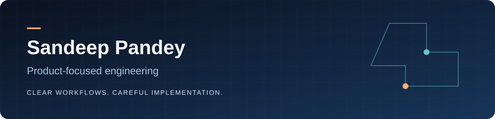

**EdTech · Web platforms · Operational systems**

[Projects](#selected-work) · [LinkedIn](https://www.linkedin.com/in/sandeeppandey6800/) · [Email](mailto:sandeeppandey6800@gmail.com)

I work at the intersection of product thinking and software development, with a focus on education and the operational workflows behind it. My projects explore how clear interfaces, reliable data and practical automation can turn complex processes into usable products.

## Selected work

| Project | Problem and implementation |
| --- | --- |
| **[SNOT Olympiad Platform](https://github.com/sndp6800/snot-platform-handover)** | School onboarding, enrollment, online exams, OMR operations, approved results and fulfillment. Python/SQLite with server-side authorization, regression tests and developer handover documentation. Local staging; tested developer handover in a private repository, with access for authorized collaborators. |
| **[EGN Connect X](https://github.com/sndp6800/EGN_Connect_X)** | Education-event website covering programme information, registration and exhibitor pages. PHP, HTML, CSS and JavaScript. |
| **[LapMate](https://github.com/sndp6800/lapmate)** | Student laptop-rental application exploring product browsing, accounts, cart and order workflows with Django. |
| **[Medicure](https://github.com/sndp6800/medicure)** | Healthcare-interface prototype with doctor, medicine and profile screens. Next.js, TypeScript and Capacitor. |

## Engineering priorities

- **Understand the workflow.** Define who owns each step, what state changes and what can fail.
- **Protect the boundaries.** Keep authorization and data validation on the server; preserve a useful audit trail.
- **Make work verifiable.** Pair changes with relevant tests, reproducible setup and clear release notes.
- **Design for the next developer.** Document the architecture, tradeoffs and unfinished work.
- **Keep product claims precise.** Distinguish prototypes, tested staging and verified production behavior.

## Current focus

Building out SNOT's school and examination workflows, improving developer handover, and connecting operational reporting with carefully scoped AI assistance.

**Tools used across these repositories:** Python · Django · JavaScript · TypeScript · React/Next.js · PHP · SQL · Git/GitHub.

## More from the workspace

[Personal portfolio](https://github.com/sndp6800/personal-portfolio) · [School-management prototype](https://github.com/sndp6800/school-management-system) · [Java & DSA practice](https://github.com/sndp6800/JAVA-DSA) · [Angular learning project](https://github.com/sndp6800/project)

Some repositories preserve earlier learning work. Their READMEs describe the implementation and current limitations rather than presenting every project as production software.
